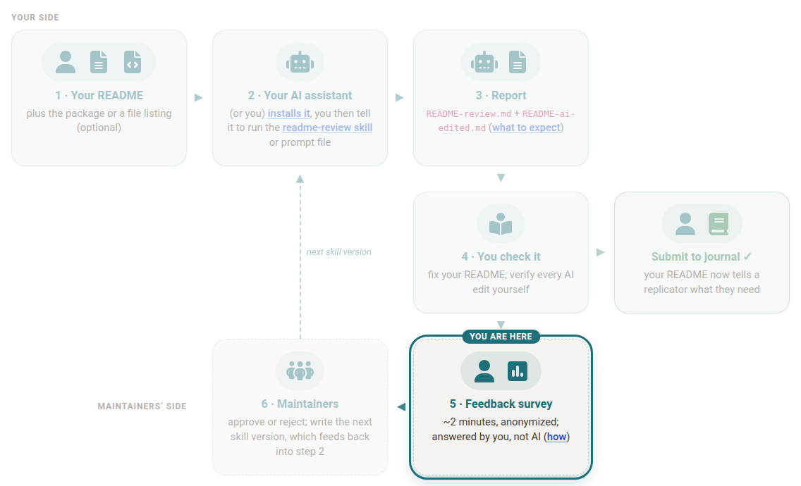

:::{div}
:class: rb-here-img

[](index.md#workflow)
:::

```{code-cell} python
:tags: [remove-cell]
import json
from IPython.display import HTML, display
site = json.load(open("site.json"))
```

Please provide feedback. The skill must evolve over time and take into account what users report as both good and bad.  Two minutes of your time should suffice.

:::{tip} Use the link at the end of your report
It records which skill version you ran. Lost it? Use this one:

```{code-cell} python
:tags: [remove-input]
display(HTML(f'<a class="rb-button" href="{site["survey_url"]}"><strong>Open the feedback survey →</strong></a>'))
```
:::

## What we most want to know

1. Did the report flag something that is **not** a real problem? Which, and why?
2. Did it **miss** a problem you know about?
3. Did the edited copy contain **invented facts**: versions, URLs, data sources, runtimes?
4. Which AI tool and model did you use, and how did you use it (chat, coding agent, API)?

## Rules for answering

- **Answer yourself.** Please do not let an AI assistant fill in the survey, except for...
- **An assistant may help with one question.** If a review went wrong, ask your assistant why, and to propose concrete changes to the skill files. Read its answer, then paste it as plain text into the "Proposed changes" question. Declare who wrote it.
- Please **Leave out** confidential data, unpublished results, and names. Note that every response is still filtered by the maintainers before it is made available to this repo.

## What happens next

1. Your response becomes a pull request in a private repository, within a day.
2. A maintainer reads it, and decides whether to include or reject it.
3. Included responses become **public** pull requests in the main repository.
4. Included responses shape the next skill version. The [changelog](https://github.com/social-science-data-editors/readme-bot/blob/main/CHANGELOG.md) cites them by ID.

## Other ways to reach us

- Did you find a bug in the skill or this page: [open an issue](https://github.com/social-science-data-editors/readme-bot/issues).
- Have a suggestion or improvement for the  Template itself: [template_README issues](https://github.com/social-science-data-editors/template_README/issues).
