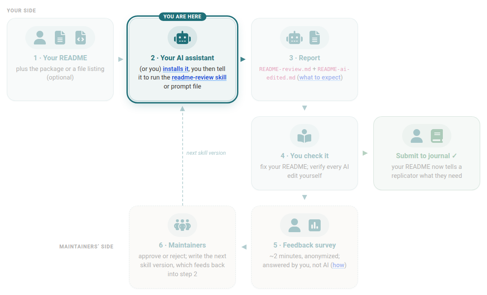

:::{div}
:class: rb-here-img

:::

## Before you install it: Security and privacy

readme-bot is **text**: instructions an AI assistant follows. It does not communicate with any (other) servers. All changes are local - they are not sent to us! Where your files go, what you are installing, and what happens to your survey answers: see the [FAQ](faq.md).

## Install

Pick the card that matches your tool. Links always point to the current version. Then [use it](use.md).

::::{grid} 1 1 3 3
:class: col-page-right

:::{card} Claude Code (or another agent that reads skills)
:header: Coding agent

1. Copy the folder [`skills/readme-review/`](https://github.com/social-science-data-editors/readme-bot/tree/main/skills/readme-review) into `.claude/skills/` in the package, or into `~/.claude/skills/` for all projects.
:::

:::{card} claude\.ai
:header: Chat with skills

1. Download [`readme-review.zip`](https://github.com/social-science-data-editors/readme-bot/releases/latest/download/readme-review.zip) (latest release).
2. Settings → Capabilities → Skills → upload the zip.
:::

:::{card} ChatGPT, Gemini, Copilot, others
:header: Any chatbot

1. Download [`readme-review-prompt.md`](https://github.com/social-science-data-editors/readme-bot/blob/main/prompts/readme-review-prompt.md).

Nothing to install: you give the file to the chat each time.
:::

::::
