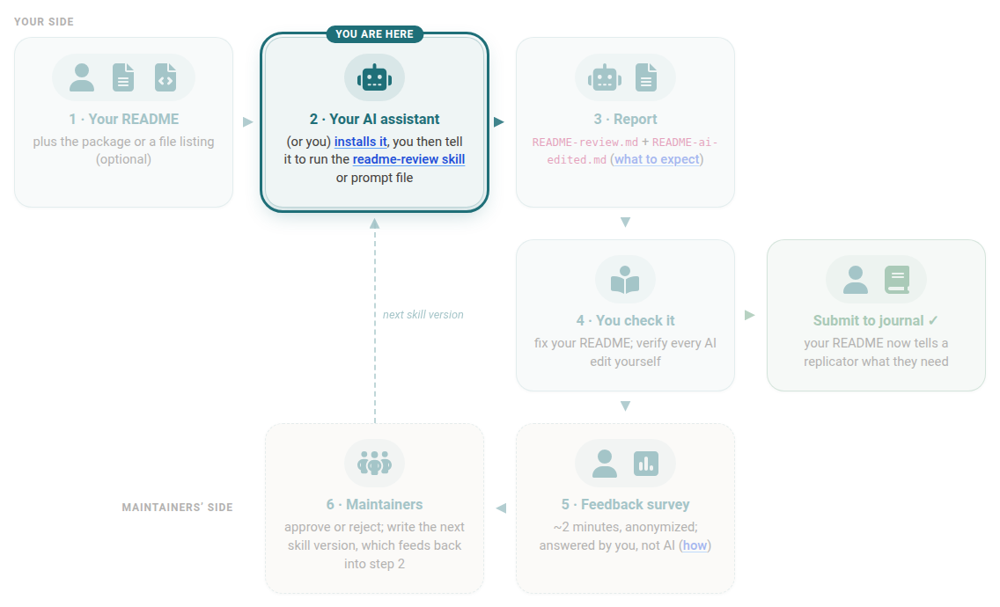

:::{div}
:class: rb-here-img

:::

[Install it](install.md) first. Then pick the card that matches your tool. All three give the same review.

::::{grid} 1 1 3 3
:class: col-page-right

:::{card} Claude Code (or another agent that reads skills)
:header: Coding agent

1. Open the package folder.
2. Ask: _"Review the README in this package."_
:::

:::{card} claude\.ai
:header: Chat with skills

1. In a new chat, attach your README (and the package zip or a file listing). Ask for a review.
:::

:::{card} ChatGPT, Gemini, Copilot, others
:header: Any chatbot

1. Download [`readme-review-prompt.md`](https://raw.githubusercontent.com/social-science-data-editors/readme-bot/main/prompts/readme-review-prompt.md), then paste it into a new chat or attach it.
2. Attach your README, and if you can, the package or its file listing.
:::

::::

## Tips

- Say _"review only"_ if you do not want an edited copy.
- Large package or restricted data? Give a file listing instead of the files: `find . -type f > files.txt` (macOS, Linux) or `dir /s /b > files.txt` (Windows).
- READMEs in PDF, Word, LaTeX, or plain text work. The edited copy is always Markdown.
- Non-English README? It is reviewed anyway; the edited copy is in English.
